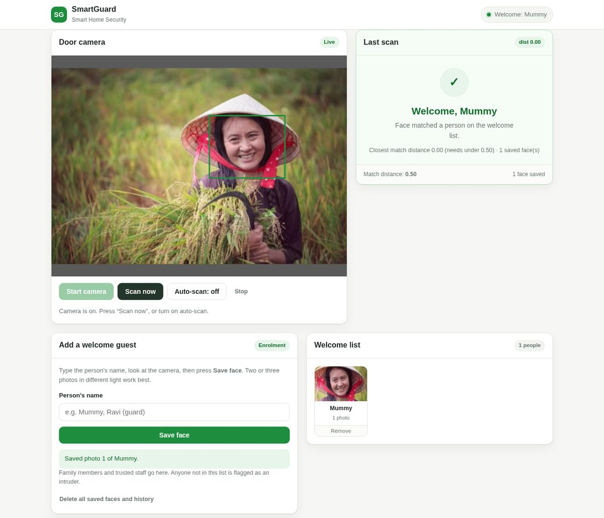

# SmartGuard — Smart Home Security System (browser version)

A face-recognition door camera that runs **completely in the browser**.
You add the faces of people who are welcome. Anyone else is flagged as an
**intruder**, with a snapshot saved.

Because there is no Python and no server, this version works as a **live
GitHub Pages link** — and every file sits in one flat folder, so a flat upload
cannot break it.



---

## Try it

1. Open the page (your GitHub Pages link, or the local steps below).
2. Wait a few seconds — the page loads about 8 MB of face models once.
3. Press **Start camera** and click **Allow**.
4. Type a name, look at the camera, press **Save face**. Do it 2–3 times.
5. Press **Scan now**. Green **"Welcome, <name>"** if it recognises you,
   red **INTRUDER ALERT** if it doesn't.

Hands-free demo mode (good for a presentation):

```
https://<your-username>.github.io/smartHome/?autostart=1&autoscan=1
```

The camera opens itself and scans every 2 seconds. Press `F11` for full screen.

---

## Files — everything in ONE folder, no subfolders

```
index.html                                     the whole app (CSS + JS inside)
face-api.js                                    face detection / recognition library
tiny_face_detector_model-weights_manifest.json
tiny_face_detector_model.bin                   finds the face in the picture
face_landmark_68_model-weights_manifest.json
face_landmark_68_model.bin                     maps 68 points on the face
face_recognition_model-weights_manifest.json
face_recognition_model.bin                     turns a face into a 128-number fingerprint
screenshot.jpg
README.md
```

All nine files must sit **next to each other**. Nothing goes in a subfolder,
so dragging them into GitHub as loose files is fine — that was the problem with
the earlier version, which needed `static/css/`, `static/js/` and `templates/`.

---

## Run it on your computer

The models are loaded with `fetch()`, which browsers block on `file://`, so use
a tiny local server instead of double-clicking the file:

```bash
cd smartHome
python -m http.server 8000
```

Then open <http://127.0.0.1:8000>.

(No Python? In VS Code install the "Live Server" extension and click
*Go Live*.)

---

## Upload to GitHub (flat, safe)

1. Create a repository called `smartHome`.
2. Click **Add file → Upload files**.
3. Select **all nine files** and drag them in. Flat is correct here.
4. **Commit changes**.
5. Settings → **Pages** → Source: **Deploy from a branch**, Branch `main`,
   Folder `/ (root)` → **Save**.
6. Wait a minute. Your link: `https://<username>.github.io/smartHome/`

---

## How the recognition works

1. **Find the face** — `tiny_face_detector` returns a box around the largest face.
2. **Map the face** — `face_landmark_68` finds 68 points (eyes, nose, mouth) and
   lines the face up straight.
3. **Fingerprint it** — `face_recognition_model` turns the face into a list of
   128 numbers. Two photos of the same person give very similar lists.
4. **Compare** — we measure the **euclidean distance** between the new
   fingerprint and every saved one:

   - **below 0.50 → welcome guest**
   - **0.50 or more → intruder**

The screen always shows the actual distance, for example
`Closest match distance 0.31 (needs under 0.50)`, so you can see how close the
decision was. If you are not being recognised, lower `THRESHOLD` to `0.45`;
if strangers get in, raise it to `0.55`.

It is in `index.html`, near the top of the script:

```js
var THRESHOLD = 0.50;
```

---

## Where the data is stored

Everything lives in your browser's `localStorage` on that device:

- `sg_people` — names, fingerprints, thumbnails
- `sg_events` — last 20 welcome / intruder events
- `sg_snapshots` — last 8 intruder photos

Nothing is uploaded anywhere. The catch: another person opening your link sees
an empty system, because their browser has its own storage. Clearing browser
data deletes it. There is a **Delete all saved faces and history** button on the
page.

---

## Troubleshooting

| Problem | Fix |
|---|---|
| "Could not load the face models" | The `.bin` and `.json` model files are missing or not next to `index.html`. |
| Camera never starts | Allow the camera in the address bar, then reload. Close Zoom/Meet — one app at a time. |
| Nothing happens on double-click | `file://` blocks the models. Run `python -m http.server 8000`. |
| "No face detected" | Move closer, face the camera, light your face (not from behind). |
| Wrong name appears | Add 2–3 more photos per person, and lower `THRESHOLD` to `0.45`. |
| Recognises nobody | Photos were taken in very different light. Re-save the face in the light you will demo in. |
| Page looks unstyled | `index.html` did not upload, or an old cached copy. Hard refresh `Ctrl+Shift+R`. |

---

## Honest limitations

- **Not real security.** This is a college project demo.
- Recognition is good but not perfect — twins and siblings can be confused.
- Only the **largest face** in the frame is checked, so two people at the door
  count as one.
- Saved faces are per browser and per device, not shared between users.
- The first visit downloads ~8 MB of models, so give it a few seconds.

## Two versions of this project

- **This one** — browser only, works on GitHub Pages, nothing to install.
- **The Python/OpenCV one** (earlier zip) — Flask server, runs on your laptop,
  uses `python app.py`. Better for showing "OpenCV" in a report; this one is
  better for a live link that actually works.

## Credits

Face detection and recognition by
[face-api.js](https://github.com/vladmandic/face-api) (MIT), running on
TensorFlow.js. UI and app logic written for this project.
